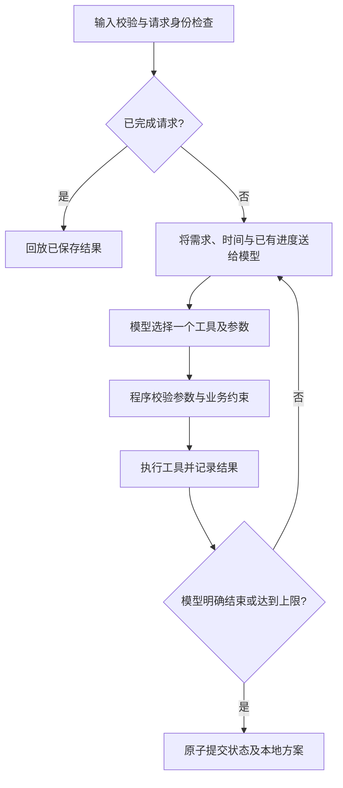

# 02 · 方案与技术取舍

## 调用流程

实际对话每轮累积上一轮 assistant 的真实 tool_calls 与对应 role=tool 观察；续跑从持久化进度摘要建立新会话，不伪造历史工具调用。

## 真实动态决策

`DeepSeekModel.choose` 每轮发送 `messages` 与 `TOOL_SCHEMAS`，读取真实 `tool_calls`。业务工具不决定下一工具，Agent 也没有“超预算就调用 basic”的固定分支。模型可自行选择查询、素材、脚本档位、重估、生成、保存或结束。

真实 Trace 的两条对照路径：

- `examples/deepseek/normal.json`：精品估算12满足预算20 → 生成 → 保存 → finish(completed)。
- `examples/deepseek/replan.json`：精品估算12超过预算10 → 模型将脚本改为basic、保留A01 → 重估10通过 → 生成与保存。

保存故障路径中，模型看到 `ok=false, retryable=false` 后选择停止；恢复路径中读取已有脚本并保存。完整记录与评估结论见03文档。

`MockModel` 明确是规则模拟器，单独维护，供无网络评审和工程测试使用。它的固定规则不作为满足 ReAct 的证明，真实接口失败也不会自动切换到它。

## 各模块职责

| 文件 | 职责 |
| --- | --- |
| domain.py | 输入校验、带时区时间、规范化指纹 |
| model.py | DeepSeek非思考模式工具调用与离线模拟器 |
| tools.py | 工具定义、参数校验、检索、估算、脚本、本地保存、结束校验 |
| agent.py | 有界决策循环、观察反馈、Trace、结果报告 |
| storage.py | SQLite请求指纹、状态与唯一方案事务 |
| cli.py | 环境/参数接入、故障注入、退出码、输出文件 |

没有使用 Agent 框架。运行依赖仅 Python 标准库（urllib、sqlite3、datetime等）；pytest仅用于测试。采用原生实现是为了在此规模下完整呈现模型与工具边界，避免为框架配置消耗有限开发时间。

模型接入遵循 [DeepSeek Tool Calls](https://api-docs.deepseek.com/guides/tool_calls/) 与 [首次调用说明](https://api-docs.deepseek.com/)。采用非思考模式，避免存储内部思维；`reason` 仅是一句公开行动说明。使用普通工具 JSON schema，并在程序中再次校验，不依赖测试版 strict 模式。

## 硬约束、状态与费用

输入由程序保存，模型没有修改预算/截止时间的工具。估算以合成费用表计算，生成与保存必须通过可行估算，保存还检查脚本与估算是否对应。微小超预算或超时也不会因展示精度四舍五入而放行。

所有费用是**方案估算**；本地工具不扣款。总费用 = 不重复素材费用之和 + 一次脚本费用。未保存时不提供最终 total_cost，保留每份候选的费用、耗时与缺口。工具调用次数与 API token usage 分开记录，token量不折算成实时账单。

状态保存发现的素材、全部候选估算、成功脚本、成功工具缓存、最终方案与历次Trace。失败结果不写成功缓存；续跑可重试失败步骤。缓存身份包含工具与业务参数，估算额外包含评估时钟，避免跨时钟复用过期报价。已完成请求直接回放。

SQLite中的 requests.id 与 plans.request_id 均有唯一约束；请求指纹阻止相同ID悄悄更换需求。状态与方案在同一事务提交，避免“声称成功但未落库”。

## 已作的简化

- 采用SQLite代替最初设想的多份JSON状态文件，便于原子提交和唯一性约束。对外仍导出可阅读JSON。
- 为保持请求与保存的一致性，本原型在单次Agent运行期间持有写事务，包含模型等待；写请求串行，锁等待10秒。未针对并发服务优化。
- 正常结束（含模型错误、工具错误或达到上限）会保存成功进度；进程被杀/机器断电时回滚本轮事务，不保证本轮新产物可恢复。此前已提交的进度可恢复。
- 耗时按评估开始时间加预计串行分钟数计算；不是实际任务执行、资源日历或API等待时间。续跑时会再次核对当前时钟。
- 检索为合成标签匹配，脚本为引用事实的本地模板；未接向量库或独立文案生成服务。
